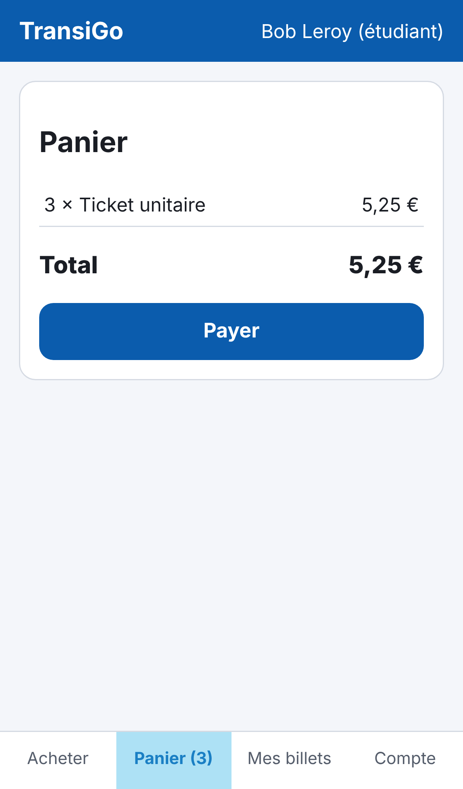
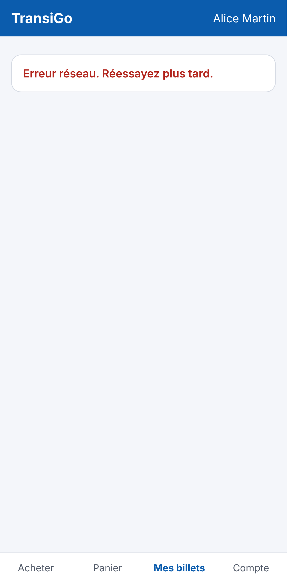
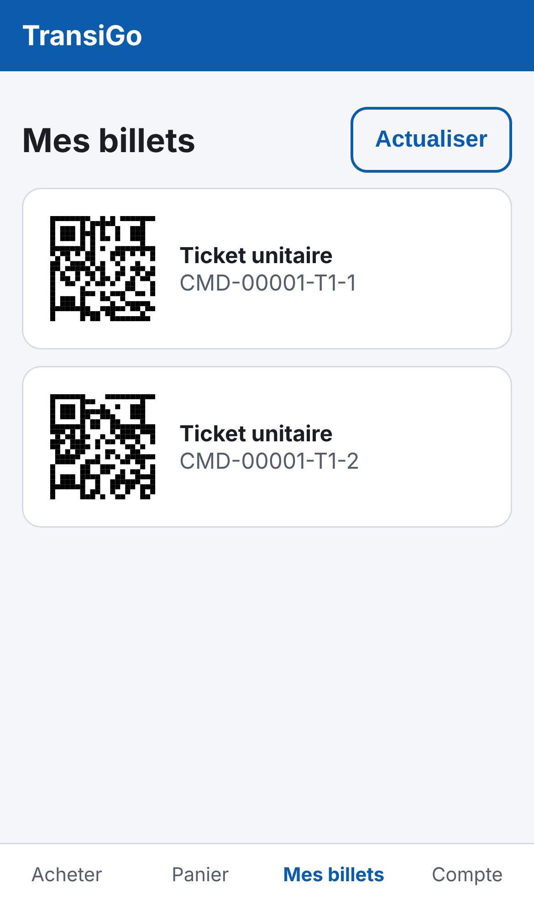

# 📱 QA Mobile — Recette fonctionnelle iOS / Android d'une application de transport


**Auteure : Mekid Asma Hayet — Testeuse fonctionnelle / QA** · Portfolio : https://mekid-portfolio.web.app/

Projet de démonstration d'une **démarche de recette complète sur une application mobile**, dans un cadre **Agile / Scrum** : de l'analyse des User Stories jusqu'à la décision **GO / NO-GO** de mise en production, sur **iOS et Android**.

> ⚠️ **TransiGo est une application fictive** que j'ai créée comme terrain d'exercice. Elle contient **8 défauts injectés volontairement** (`APP_DEFECTS=on`) et une version corrigée (`APP_DEFECTS=off`). Ce qui compte ici est la **démarche QA**, pas l'application.

---

## 🎯 En 30 secondes

| | Campagne 1 (v1.4.0-rc1) | Campagne 2 (v1.4.0-rc2) |
|---|---|---|
| Exécutions automatisées (23 cas × iOS + Android) | 30 / 46 OK | **46 / 46 OK** |
| Anomalies ouvertes (Bloquant / Critique / Majeur / Mineur) | 2 / 2 / 2 / 2 | **0** |
| Décision | 🔴 **NO-GO** | 🟢 **GO** |

Exemples d'anomalies trouvées : **double débit** sur double appui, **billets invisibles hors ligne** (client verbalisé dans le métro), **surfacturation** des étudiants, **billets visibles après déconnexion**, boutons **inaccessibles à VoiceOver/TalkBack**.

| Tarif réduit faux (BUG-001) | Hors ligne (BUG-002) | Après déconnexion (BUG-005) |
|---|---|---|
|  |  |  |

---

## 🧭 Ce que démontre ce projet

| Compétence attendue d'un·e testeur·se fonctionnel·le mobile | Où le voir |
|---|---|
| Analyse des User Stories et des critères d'acceptation | [02 — US, Gherkin, 9 questions au PO, 4 critères ajoutés](docs/02-user-stories-et-analyse.md) |
| Définition de la stratégie de recette | [01 — Stratégie par les risques, sévérités, critères GO/NO-GO](docs/01-strategie-recette.md) |
| Plans de tests et scénarios de qualification | [03 — Plan de test](docs/03-plan-de-test.md) |
| Cahier de recette et jeux de données | [📊 cahier-de-recette.xlsx](docs/cahier-de-recette.xlsx) (35 cas, 2 campagnes, synthèse calculée) · [04 — Jeux de données](docs/04-jeux-de-donnees.md) |
| Spécificités iOS / Android | [05 — Matrice d'appareils et différences iOS/Android](docs/05-matrice-appareils.md) · [06 — 12 cas sur device réel](docs/06-tests-manuels-mobile.md) (interruptions, retour système, VoiceOver/TalkBack, réseau dégradé…) |
| Tests de bout en bout et de non-régression | [tests/](tests/) — 23 cas automatisés exécutés sur profil iPhone 13 et Pixel 7 |
| Expérience utilisateur et accessibilité numérique | [tests/test_accessibilite.py](tests/test_accessibilite.py) (axe-core, RGAA/WCAG, mode sombre) + zones tactiles, clavier, orientation, petits écrans |
| Qualification et documentation des anomalies (JIRA) | [8 fiches d'anomalies](docs/anomalies/) avec étapes, attendu/obtenu, impact, capture · [import CSV JIRA](docs/anomalies/jira-import.csv) |
| Suivi d'incidents de production (ServiceNow) | [Incident SNOW → qualification → anomalie JIRA → clôture](docs/anomalies/SNOW-INC0012874.md) |
| Vérification des correctifs et décision de MEP | [Rapport Campagne 1 — NO-GO](docs/07-rapport-campagne-1.md) · [Rapport Campagne 2 — GO](docs/08-rapport-campagne-2.md) |
| Rituels Agile (Refinement, Planning, Daily, Review, Rétro) | [Sprint 12 — contribution QA](docs/agile/sprint-12-rituels.md) · [DoR / DoD](docs/agile/definition-of-ready-done.md) |

---

## 🗂️ Structure

```
app/                    Application de démo (Flask + page mobile), défauts activables
tests/                  Tests automatisés Playwright + pytest (iOS / Android émulés)
docs/
  01..06                Stratégie, US, plan de test, jeux de données, appareils, cas manuels
  07, 08                Rapports de campagne générés (NO-GO puis GO)
  cahier-de-recette.xlsx
  anomalies/            BUG-001..008, captures, import JIRA, exemple d'incident SNOW
  agile/                DoR/DoD, rituels du sprint
tools/generate_report.py  JUnit -> rapport Markdown avec décision GO/NO-GO
.github/workflows/qa.yml  CI : non-régression + démo de détection des défauts
```

## ▶️ Lancer les campagnes

```bash
pip install -r requirements.txt
python -m playwright install chromium webkit

# Campagne 1 — version avec défauts (NO-GO attendu)
APP_DEFECTS=on  python -m pytest --junitxml=reports/campagne1-junit.xml
python tools/generate_report.py reports/campagne1-junit.xml docs/07-rapport-campagne-1.md "Campagne 1" "v1.4.0-rc1"

# Campagne 2 — version corrigée (GO attendu)
APP_DEFECTS=off python -m pytest --junitxml=reports/campagne2-junit.xml
python tools/generate_report.py reports/campagne2-junit.xml docs/08-rapport-campagne-2.md "Campagne 2" "v1.4.0-rc2"
```

Voir l'application : `python app/server.py` puis ouvrir http://localhost:5050 en mode « appareil mobile » du navigateur (comptes dans [04 — Jeux de données](docs/04-jeux-de-donnees.md)).

Options : `IOS_ENGINE=chromium` exécute le profil iPhone sur Chromium si WebKit n'est pas installé ; `PW_CHANNEL=chrome` utilise le Chrome du poste.

## 🔎 Limites, en toute transparence
- Les tests automatisés **émulent** les appareils (taille d'écran, tactile, user-agent, moteur WebKit/Chromium). Ils ne remplacent pas les **devices réels** : les 12 cas CT-M01 à CT-M12 (interruptions, VoiceOver/TalkBack, réseau réel, mise à jour) sont conçus mais **non exécutés** dans ce dépôt.
- Les rapports commités ont été produits avec le profil iOS exécuté sur Chromium (WebKit non disponible sur le poste de génération) ; la CI GitHub exécute le profil iOS sur **WebKit**.
- JIRA et ServiceNow sont représentés par des fiches au format de ces outils et un CSV d'import JIRA ; le mapping des colonnes peut demander un ajustement à l'import.
- L'automatisation sert ici la **non-régression** ; le cœur du métier reste l'analyse, la conception des cas et la qualification des anomalies.
