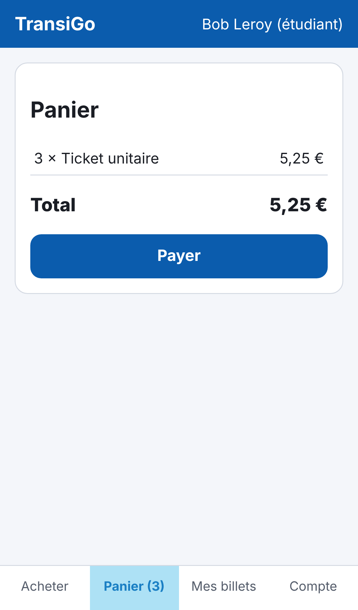

# BUG-001 — [Tarif réduit] La réduction étudiante n'est appliquée qu'à un seul ticket quand la quantité est > 1

| Champ JIRA | Valeur |
|---|---|
| Type | Bug |
| Sévérité | **Critique** |
| Priorité | Haute |
| Composant | Tarification |
| User Story liée | US-03 |
| Cas de test | CT-06 |
| Version détectée | v1.4.0-rc1 (Campagne 1) |
| Environnement | QUALIF — iOS (iPhone 13) **et** Android (Pixel 7) — reproductible 100 % |
| Statut | ✅ Fermée — corrigée en v1.4.0-rc2, vérifiée en Campagne 2 |

## Prérequis
Compte bob@transigo.fr (profil étudiant -50 %)

## Étapes de reproduction
1. Se connecter avec bob@transigo.fr / Test1234!
2. Ajouter 3 « Ticket unitaire » (bouton +)
3. Ouvrir le panier

## Résultat attendu
Total = 3 × 1,05 € = **3,15 €** (règle US-03 : -50 % sur chaque unité)

## Résultat obtenu
Total affiché = **5,25 €** (6,30 € − 1,05 € : réduction appliquée une seule fois). Client surfacturé de 2,10 €.

## Impact utilisateur / métier
Surfacturation de tous les étudiants achetant plusieurs titres → réclamations, remboursements, risque d'image et juridique (tarification réglementée).

## Preuve

## Correction et vérification
- Correctif : Calcul de la réduction par unité côté serveur (`price × qty × 0,5`).
- Re-test CT-06 sur iOS et Android en Campagne 2 : ✅ OK
- Non-régression complète (46 exécutions) : ✅ OK
