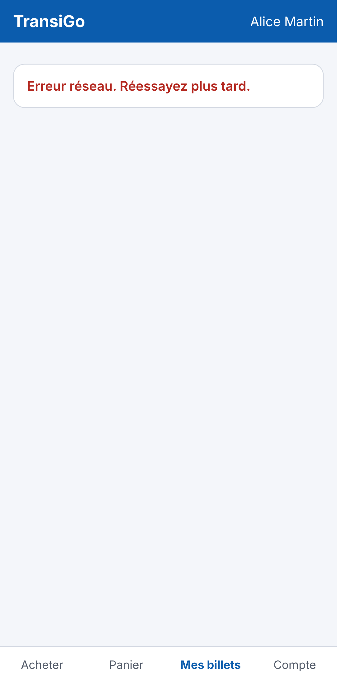

# BUG-002 — [Hors ligne] Les billets achetés ne s'affichent plus sans réseau — message « Erreur réseau »

| Champ JIRA | Valeur |
|---|---|
| Type | Bug |
| Sévérité | **Bloquant** |
| Priorité | Très haute |
| Composant | Billets / hors ligne |
| User Story liée | US-05 |
| Cas de test | CT-13 |
| Version détectée | v1.4.0-rc1 (Campagne 1) |
| Environnement | QUALIF — iOS (iPhone 13) **et** Android (Pixel 7) — reproductible 100 % |
| Statut | ✅ Fermée — corrigée en v1.4.0-rc2, vérifiée en Campagne 2 |

## Prérequis
Compte Alice, 1 billet acheté et déjà affiché une fois en ligne

## Étapes de reproduction
1. Se connecter, acheter 1 ticket unitaire
2. Sur « Mes billets », vérifier que le billet s'affiche
3. Passer en mode avion
4. Appuyer sur « Actualiser »

## Résultat attendu
Le billet reste affiché avec son QR code + bandeau « Hors ligne — billets enregistrés sur ce téléphone »

## Résultat obtenu
Écran « Erreur réseau. Réessayez plus tard. », aucun billet visible.

## Impact utilisateur / métier
Le voyageur ne peut pas présenter son titre dans le métro (pas de réseau) → **verbalisation d'un client qui a payé**. Aucun contournement.

## Preuve

## Correction et vérification
- Correctif : En cas d'erreur réseau, afficher les billets du cache local avec le bandeau hors ligne.
- Re-test CT-13 sur iOS et Android en Campagne 2 : ✅ OK
- Non-régression complète (46 exécutions) : ✅ OK
