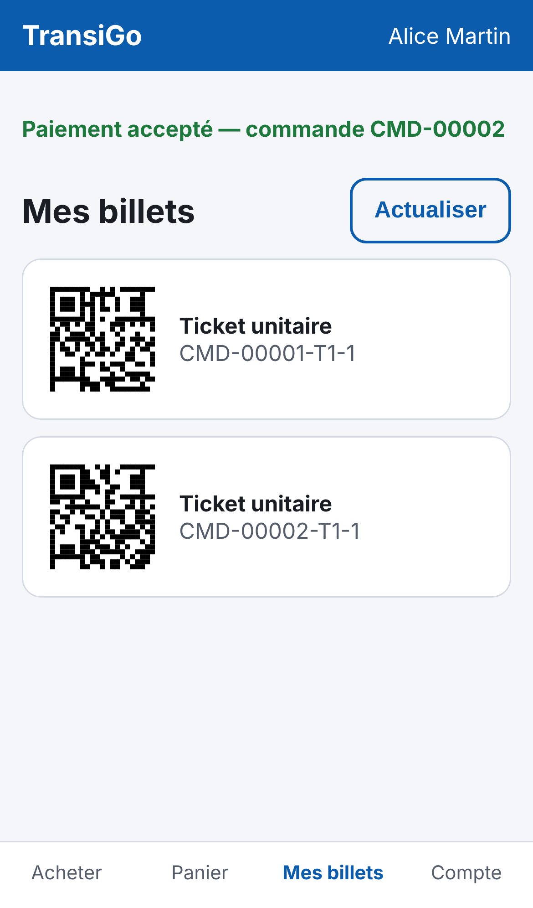

# BUG-003 — [Paiement] Un double appui sur « Confirmer le paiement » crée 2 commandes et 2 débits

| Champ JIRA | Valeur |
|---|---|
| Type | Bug |
| Sévérité | **Bloquant** |
| Priorité | Très haute |
| Composant | Paiement |
| User Story liée | US-04 |
| Cas de test | CT-12 |
| Version détectée | v1.4.0-rc1 (Campagne 1) |
| Environnement | QUALIF — iOS (iPhone 13) **et** Android (Pixel 7) — reproductible 100 % |
| Statut | ✅ Fermée — corrigée en v1.4.0-rc2, vérifiée en Campagne 2 |

## Prérequis
Compte Alice, 1 ticket au panier, carte valide JDD-C1

## Étapes de reproduction
1. Remplir le formulaire de paiement avec une carte valide
2. Appuyer deux fois rapidement sur « Confirmer le paiement »

## Résultat attendu
Une seule commande, un seul débit (critère d'acceptation US-04 « Double appui »)

## Résultat obtenu
**2 commandes** créées (CMD-00001 et CMD-00002) → client débité deux fois.

## Impact utilisateur / métier
Double débit : réclamations, remboursements manuels, perte de confiance. Très fréquent sur mobile (double tap, réseau lent).

## Preuve

## Correction et vérification
- Correctif : Bouton désactivé dès le 1er appui + clé d'idempotence vérifiée côté serveur.
- Re-test CT-12 sur iOS et Android en Campagne 2 : ✅ OK
- Non-régression complète (46 exécutions) : ✅ OK
