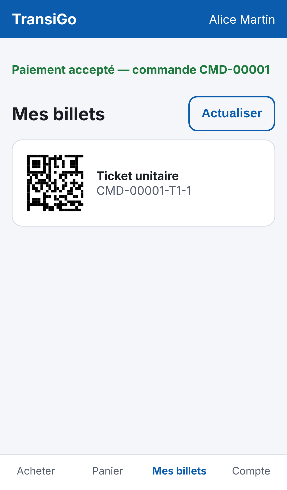

# BUG-004 — [Paiement] Une carte expirée (01/24) est acceptée et des billets sont émis

| Champ JIRA | Valeur |
|---|---|
| Type | Bug |
| Sévérité | **Critique** |
| Priorité | Haute |
| Composant | Paiement |
| User Story liée | US-04 |
| Cas de test | CT-10 |
| Version détectée | v1.4.0-rc1 (Campagne 1) |
| Environnement | QUALIF — iOS (iPhone 13) **et** Android (Pixel 7) — reproductible 100 % |
| Statut | ✅ Fermée — corrigée en v1.4.0-rc2, vérifiée en Campagne 2 |

## Prérequis
Compte Alice, 1 ticket au panier

## Étapes de reproduction
1. Saisir la carte 4111 1111 1111 1111, expiration 01/24, CVV 123
2. Confirmer le paiement

## Résultat attendu
Message « Carte expirée », aucune commande créée

## Résultat obtenu
Paiement accepté, commande créée et billet émis.

## Impact utilisateur / métier
Billets émis sans paiement valide → perte de recettes ; incohérence avec le prestataire de paiement.

## Preuve

## Correction et vérification
- Correctif : Contrôle de la date d'expiration (mois/année ≥ mois courant).
- Re-test CT-10 sur iOS et Android en Campagne 2 : ✅ OK
- Non-régression complète (46 exécutions) : ✅ OK
