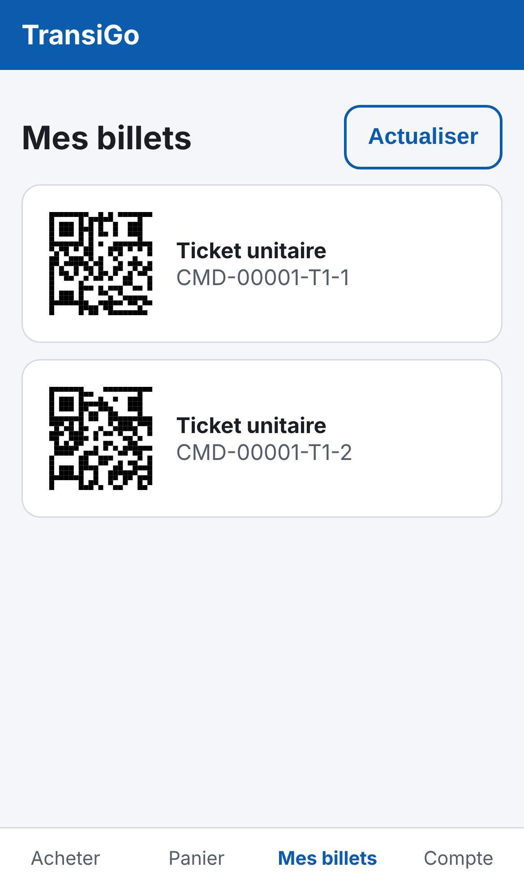

# BUG-005 — [Sécurité] Après déconnexion, les billets du compte précédent restent visibles dans « Mes billets »

| Champ JIRA | Valeur |
|---|---|
| Type | Bug |
| Sévérité | **Majeur** |
| Priorité | Haute |
| Composant | Session / sécurité |
| User Story liée | US-06 |
| Cas de test | CT-14 |
| Version détectée | v1.4.0-rc1 (Campagne 1) |
| Environnement | QUALIF — iOS (iPhone 13) **et** Android (Pixel 7) — reproductible 100 % |
| Statut | ✅ Fermée — corrigée en v1.4.0-rc2, vérifiée en Campagne 2 |

## Prérequis
Compte Alice avec 2 billets

## Étapes de reproduction
1. Se connecter, acheter 2 tickets
2. Onglet Compte → Se déconnecter
3. Ouvrir directement l'écran « Mes billets » (lien / historique)

## Résultat attendu
Retour à l'écran de connexion, aucun billet visible (cache effacé à la déconnexion — arbitrage PO US-06)

## Résultat obtenu
Les 2 billets d'Alice s'affichent alors que personne n'est connecté.

## Impact utilisateur / métier
Téléphone prêté/partagé : un tiers peut voir et **utiliser** les billets → fraude + non-conformité RGPD.

## Preuve

## Correction et vérification
- Correctif : Effacer le cache à la déconnexion + protéger la route « Mes billets ».
- Re-test CT-14 sur iOS et Android en Campagne 2 : ✅ OK
- Non-régression complète (46 exécutions) : ✅ OK
