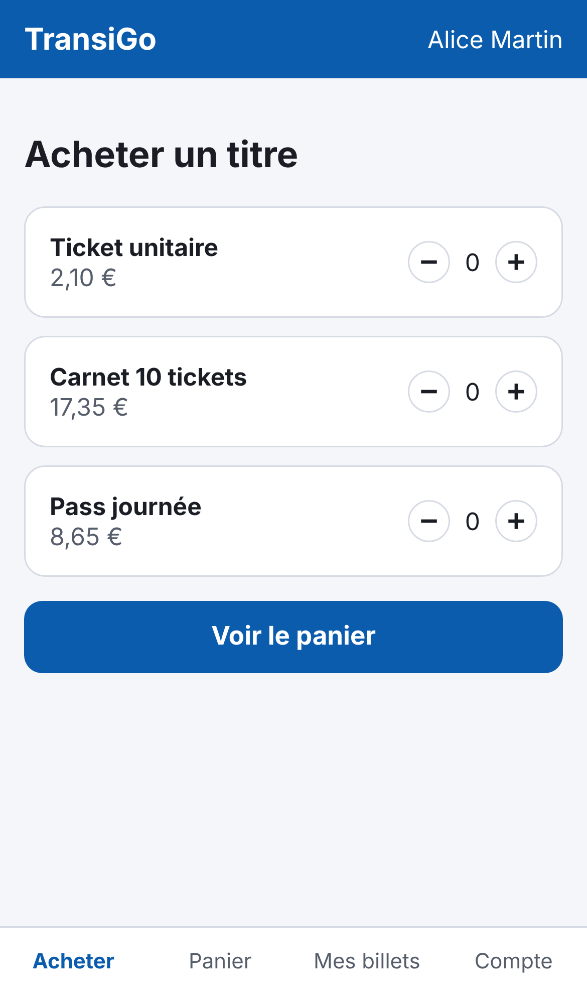

# BUG-006 — [Accessibilité] Les boutons +/− du catalogue n'ont pas de nom accessible (VoiceOver/TalkBack lisent « bouton »)

| Champ JIRA | Valeur |
|---|---|
| Type | Bug |
| Sévérité | **Majeur** |
| Priorité | Moyenne |
| Composant | Accessibilité |
| User Story liée | US-02 |
| Cas de test | CT-18 |
| Version détectée | v1.4.0-rc1 (Campagne 1) |
| Environnement | QUALIF — iOS (iPhone 13) **et** Android (Pixel 7) — reproductible 100 % |
| Statut | ✅ Fermée — corrigée en v1.4.0-rc2, vérifiée en Campagne 2 |

## Prérequis
Écran « Acheter un titre »

## Étapes de reproduction
1. Ouvrir le catalogue
2. Lancer l'audit axe-core (ou activer VoiceOver/TalkBack et parcourir)

## Résultat attendu
Chaque bouton annonce son action : « Augmenter la quantité de Ticket unitaire »

## Résultat obtenu
axe-core : règle `button-name` (critique) sur 6 boutons. Un utilisateur non-voyant ne peut pas choisir ses titres.

## Impact utilisateur / métier
Parcours d'achat inaccessible aux personnes malvoyantes ; non-conformité RGAA 4.1 (critère 11.9) — obligation légale.

## Preuve

## Correction et vérification
- Correctif : Ajouter `aria-label` (iOS : accessibilityLabel / Android : contentDescription).
- Re-test CT-18 sur iOS et Android en Campagne 2 : ✅ OK
- Non-régression complète (46 exécutions) : ✅ OK
