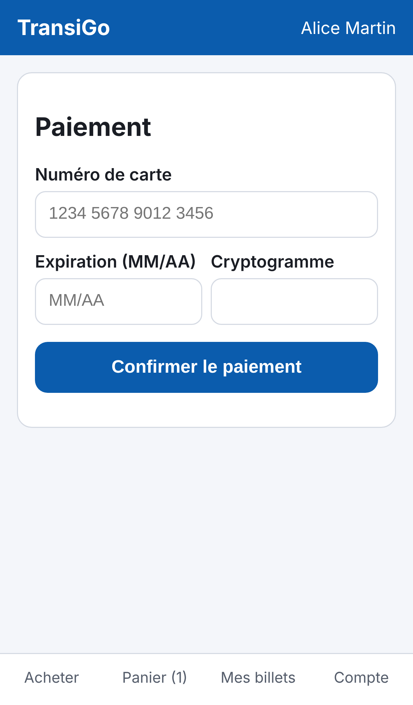

# BUG-008 — [UX] Le champ « Numéro de carte » ouvre le clavier alphabétique au lieu du pavé numérique

| Champ JIRA | Valeur |
|---|---|
| Type | Bug |
| Sévérité | **Mineur** |
| Priorité | Basse |
| Composant | Paiement / UX |
| User Story liée | US-04 |
| Cas de test | CT-16 |
| Version détectée | v1.4.0-rc1 (Campagne 1) |
| Environnement | QUALIF — iOS (iPhone 13) **et** Android (Pixel 7) — reproductible 100 % |
| Statut | ✅ Fermée — corrigée en v1.4.0-rc2, vérifiée en Campagne 2 |

## Prérequis
Écran Paiement

## Étapes de reproduction
1. Ouvrir l'écran de paiement
2. Toucher le champ « Numéro de carte »

## Résultat attendu
Pavé numérique + suggestion d'autoremplissage de carte (iOS/Android)

## Résultat obtenu
Clavier alphabétique ; pas d'autoremplissage (attributs `inputmode` / `autocomplete` absents).

## Impact utilisateur / métier
Saisie plus longue et plus d'erreurs. Contournement : basculer le clavier manuellement.

## Preuve

## Correction et vérification
- Correctif : `inputmode="numeric"` + `autocomplete="cc-number"`.
- Re-test CT-16 sur iOS et Android en Campagne 2 : ✅ OK
- Non-régression complète (46 exécutions) : ✅ OK
